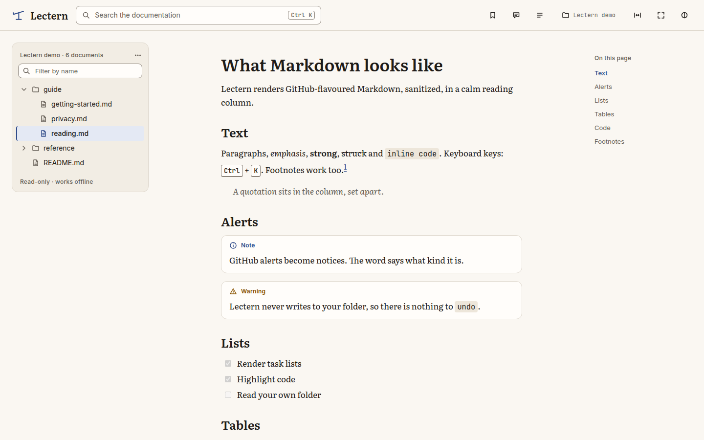
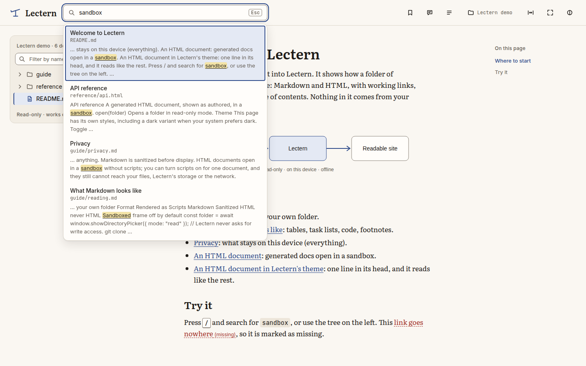
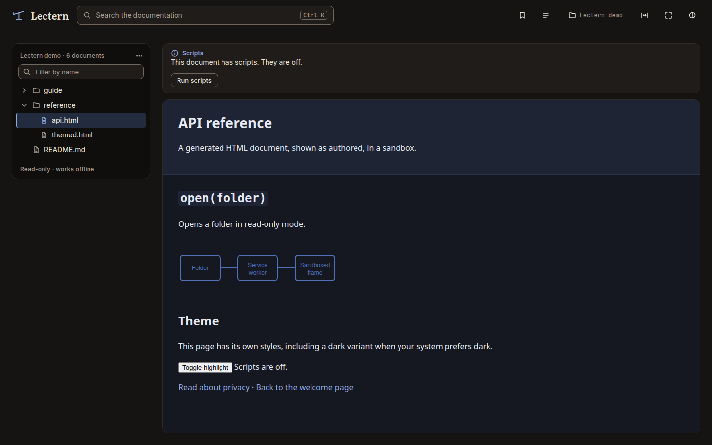

# Lectern

**Your docs, read where they live.**

Lectern is an installable web app that opens a folder on your computer and shows its documentation (Markdown and HTML) as a calm, searchable site. No build step, no server, no account. It is a reading tool, not an editor or an IDE.



## What it does

- **Opens a folder** from your machine (a repository, its `docs/`) and lists its documents in a tree, skipping `node_modules`, build output, hidden folders and what the root `.gitignore` ignores.
- **Renders Markdown** the way GitHub does: tables, task lists, footnotes, strikethrough, autolinks, frontmatter, heading anchors, a table of contents, and highlighted code (40 languages) with a copy button.
- **Opens HTML documents** (generated API docs, for example) in a sandbox, with their relative styles, images and SVG working. Scripts are off; you can turn them on for one document.
- **Follows links** between documents, Markdown and HTML alike, with back and forward; relative images just work; broken links say so.
- **Searches** titles and contents as you type, with highlighted excerpts. The index builds in the background, updates itself when files change, and is ready instantly next time.
- **Remembers** the folders you opened (switch or forget them), the last document and its scroll position. Reopening takes at most one click.
- **Reloads live**: edit a file in your editor and the open document, the tree and the search index follow, keeping your place.
- **Keeps your notes.** Bookmark a document, or add a Markdown note on a selection or the section you are reading. Notes live in the browser, never in your folder, and can be exported as JSON.
- **Adapts to you**: reading width, zen mode, resizable tree, light, dark or system theme, keyboard and screen-reader friendly (checked with axe in both themes).
- **Works offline** once installed.

Press **Try the demo folder** on the first screen to see it without opening anything.

| Search                                                           | HTML documents                                                                              |
| ---------------------------------------------------------------- | ------------------------------------------------------------------------------------------- |
|  |  |

## Privacy

Nothing leaves this device.

- **Read-only.** Lectern only ever asks to read the folder. No code path writes to it.
- **No network.** After the app is installed, it makes no request at all: no telemetry, no analytics, no remote fonts, scripts or icons. A strict Content Security Policy (`connect-src 'none'`, Trusted Types) enforces it, and automated tests fail if a request would leave.
- **Untrusted content stays contained.** Markdown is sanitized; HTML documents run in a sandbox that cannot reach your files, Lectern's storage or the network, even with scripts on.
- **What is kept, locally:** the folders you opened (to reopen them), your last position, your bookmarks and notes, your preferences and a search index, in the browser's storage for Lectern.

Details: [docs/security.md](docs/security.md).

## Supported browsers

**Chrome and Edge 130 or later**, on desktop. Lectern reads folders with the File System Access API, which only Chromium browsers provide today; other browsers show an explanation instead. A reduced mode for Firefox and Safari is on the [roadmap](docs/roadmap.md).

## Run it

Lectern is a static site (the hosted version is at <https://lectern.creasource.app/>). Download `lectern-X.Y.Z.zip` from the [latest release](../../releases/latest) (or build it, see below) and serve its contents from any static host over HTTPS (or `localhost`), then install it from the browser. For deep links to work on a first visit, the host should serve `index.html` for unknown paths.

## Development

Lectern uses [Vite+](https://viteplus.dev) (`vp`), with Preact, TypeScript, unified, Shiki and MiniSearch. With the global CLI, or through `pnpm vp …`:

```bash
pnpm install
```

```bash
vp dev            # dev server
vp check          # format, lint, type-check (--fix to fix)
vp test           # unit tests
vp build          # production build
pnpm test:e2e     # Playwright, against the production build
pnpm screenshots  # regenerate the README screenshots
```

Read [CONTRIBUTING.md](CONTRIBUTING.md), [docs/architecture.md](docs/architecture.md) and the decision records in [docs/decisions/](docs/decisions/).

## Licence

MIT. Fonts (Literata, Inter, JetBrains Mono) are under the SIL Open Font License, see [THIRD_PARTY_LICENSES](THIRD_PARTY_LICENSES/README.md).
