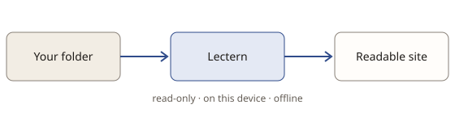

# Welcome to Lectern

This is a demo folder, built into Lectern. It shows how a folder of documentation reads here: Markdown and HTML, with working links, images, search and a table of contents. Nothing in it comes from your computer.

## Where to start

- [Getting started](guide/getting-started.md): open your own folder.
- [What Markdown looks like](guide/reading.md): tables, task lists, code, footnotes.
- [Privacy](guide/privacy.md): what stays on this device (everything).
- [An HTML document](reference/api.html): generated docs open in a sandbox.
- [An HTML document in Lectern's theme](reference/themed.html): one line in its head, and it reads like the rest.

## Try it

Press <kbd>/</kbd> and search for `sandbox`, or use the tree on the left. This [link goes nowhere](guide/missing.md), so it is marked as missing.
